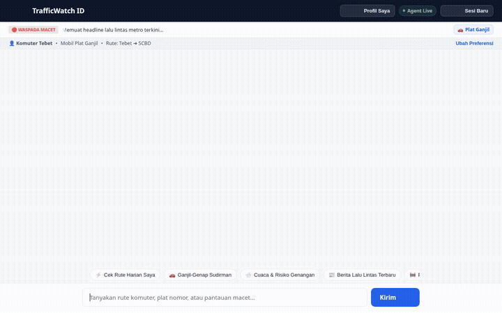

# TrafficWatch Indonesia 🚦🇮🇩

**TrafficWatch Indonesia** is an autonomous AI commuter assistant designed for Jakarta and Jabodetabek commuters. Powered by **Google Gemini 3.7 Flash** and built with the **Google Agent Development Kit (ADK)**, it delivers real-time traffic disruption alerts, Odd-Even (*Ganjil-Genap*) compliance checks, live weather/flood risk assessments, and multimodal infographic/video generation.



---

## 🌟 Key Implemented Features & Google Cloud Services

The agent is wired with the following Google Cloud and ADK services:

1. **Vertex AI Agent Platform & Gemini 3.7 Flash**:
   * Core conversational agent engine running with A2A (Agent-to-Agent) protocol.
   * Delivers structured, card-based UI via **A2UI** (*Agent-to-UI*) specifications.

2. **Vertex AI Memory Bank (Long-Term Memory)**:
   * **`PreloadMemoryTool`** & **`generate_memories_callback`**: Persists commuter routes (e.g. *Tebet ➜ SCBD*), vehicle license plates (odd/even), transit habits, and preferred corridors across sessions.
   * Built-in **"Profil Saya"** onboarding drawer with instant sync to Memory Bank.

3. **Running Text News Ticker & Municipal Indicators**:
   * Smooth horizontal running text marquee streaming live metro transit alerts from Antara News RSS with hover-to-pause and automatic 5-minute background refresh.
   * Real-time Ganjil-Genap rule badge computed dynamically from current Indonesian date.

4. **Cloud Firestore (`traffic_alerts`)**:
   * Real-time NoSQL store for incident logging, road closures, demonstration advisories, and status updates (`active`, `resolved`).

5. **Cloud Storage (Asset Hosting)**:
   * Public storage bucket hosting generated route map schematics, infographics, and commuter video clips.

6. **Multimodal Generation Tools**:
   * **`generate_traffic_alert_image`**: Generates visual road detour schematics and advisory infographics using `gemini-3.1-flash-lite-image`.
   * **`generate_traffic_alert_video`**: Generates short situational video clips for road/weather advisories using Google's Omni model (`gemini-omni-flash-preview`) in the global region.
   * Both tools save artifacts directly to session memory (`tool_context.save_artifact`) and upload to Cloud Storage.

7. **Agent Engine Code Sandbox**:
   * **`AgentEngineSandboxCodeExecutor`**: Secure execution sandbox for calculating dynamic travel time estimates and route algorithms.

8. **External APIs & Geocoding Tools**:
   * **Google Maps Geocoding & Places (New)**: Location resolution and transit hub lookups.
   * **Open-Meteo Weather & Flood Risk**: Real-time precipitation and flood vulnerability alerts for Jakarta corridors.
   * **TMC Polda Metro RSS Feed**: Ingestion of official traffic police updates.

---

## 🛠️ Implemented Agent Tools

| Tool Name | Service / Provider | Purpose |
| :--- | :--- | :--- |
| `preload_memory` | Vertex AI Memory Bank | Recalls saved user commute preferences and vehicle plate information |
| `list_traffic_alerts` | Google Cloud Firestore | Queries active traffic alerts, roadworks, and rally disruptions |
| `get_traffic_alert_details` | Google Cloud Firestore | Retrieves detailed incident info, affected lanes, and bypass routes |
| `report_traffic_alert` | Google Cloud Firestore | Allows commuters and operators to report new traffic incidents |
| `update_traffic_alert_status` | Google Cloud Firestore | Resolves or updates existing traffic disruption alerts |
| `fetch_traffic_rss_alerts` | TMC Polda Metro Jaya | Fetches official real-time traffic and demonstration advisories |
| `get_route_weather_and_flood_risk` | Open-Meteo API | Evaluates weather intensity and rain-induced flood risk along corridors |
| `geocode_address` | Google Maps API | Converts Jakarta landmarks and addresses into coordinates |
| `find_nearby_places` | Google Maps API | Locates nearby MRT/LRT stations, gas stations, or emergency points |
| `generate_traffic_alert_image` | Gemini Image (`gemini-3.1-flash-lite-image`) | Generates visual road schematics and detour infographics |
| `generate_traffic_alert_video` | Google Omni (`gemini-omni-flash-preview`) | Generates situational video clips for corridor updates |

*(Note: Vertex AI RAG Engine corpus grounding is planned for transit regulations and not yet implemented).*

---

## 🚀 Local Setup & Run Guide

### Prerequisites
* Python 3.11+
* `uv` package manager (`pip install uv`)
* Google Cloud CLI (`gcloud`) authenticated with access to Vertex AI, Firestore, and Cloud Storage.

### 1. Clone & Set Up the Agent
```bash
git clone https://github.com/hanifnew/buildwithgemini-trafficwatch-id.git
cd buildwithgemini-trafficwatch-id

# Install dependencies using uv
uv sync
```

### 2. Configure Environment Variables
Set your Google Cloud credentials and API keys:
```bash
export GOOGLE_GENAI_USE_VERTEXAI=true
export GOOGLE_CLOUD_PROJECT="<YOUR_GCP_PROJECT_ID>"
export GOOGLE_CLOUD_LOCATION="us-east1"
export GOOGLE_MAPS_API_KEY="<YOUR_GOOGLE_MAPS_API_KEY>"
export MEMORY_BANK_ID="<YOUR_MEMORY_BANK_ID>"
```

### 3. Run the Agent Locally via ADK Web
Run the ADK development playground:
```bash
uv run adk web . --port 8000 --reload_agents --memory_service_uri=agentengine://<YOUR_MEMORY_BANK_ID>
```

### 4. Run the Custom Chat Frontend
To run the lightweight FastAPI chat proxy with built-in A2UI card renderer:
```bash
cd frontend

# Install frontend dependencies
uv sync

# Set agent engine target or local mock
export AGENT_ENGINE_RESOURCE_NAME="projects/<PROJECT_NUM>/locations/us-east1/reasoningEngines/<REASONING_ENGINE_ID>"
export AGENT_DIRECTORY="app"
export PORT="8080"

python main.py
```

---

## 🏛️ Architecture Overview

```
[ Commuter Browser ]
        │
        ▼ (HTTP / JSON)
[ FastAPI Proxy (Cloud Run) ]
        │
        ▼ (A2A Protocol / gRPC)
[ Vertex AI Agent Platform (Gemini 3.7 Flash) ]
        ├── A2UI Callback ─────────► [ Structured Card UI (Ganjil-Genap / Routes) ]
        ├── Long-Term Memory ──────► [ Vertex AI Memory Bank ]
        ├── Live Incident Store ───► [ Cloud Firestore ]
        ├── Image / Video Gen ─────► [ Gemini Image & Omni Model -> Cloud Storage ]
        └── Real-time APIs ────────► [ Google Maps & Open-Meteo ]
```
